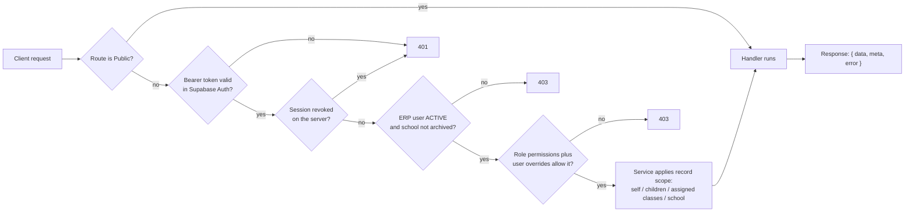
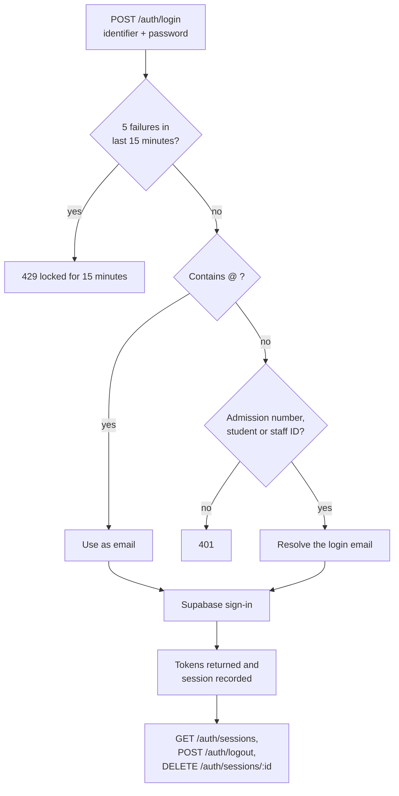
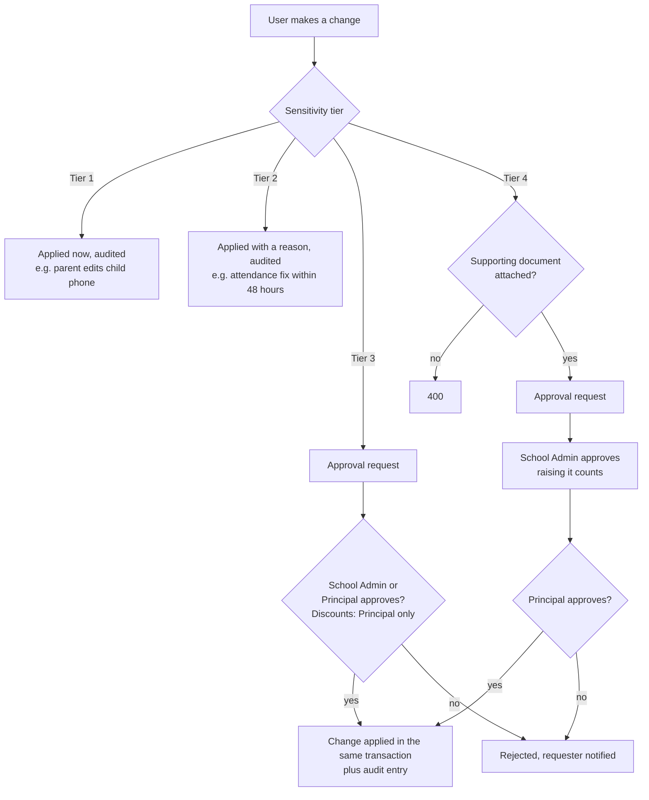
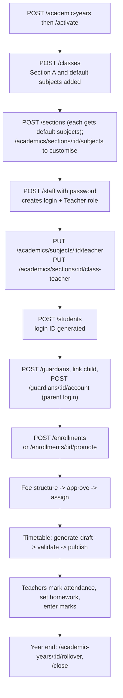
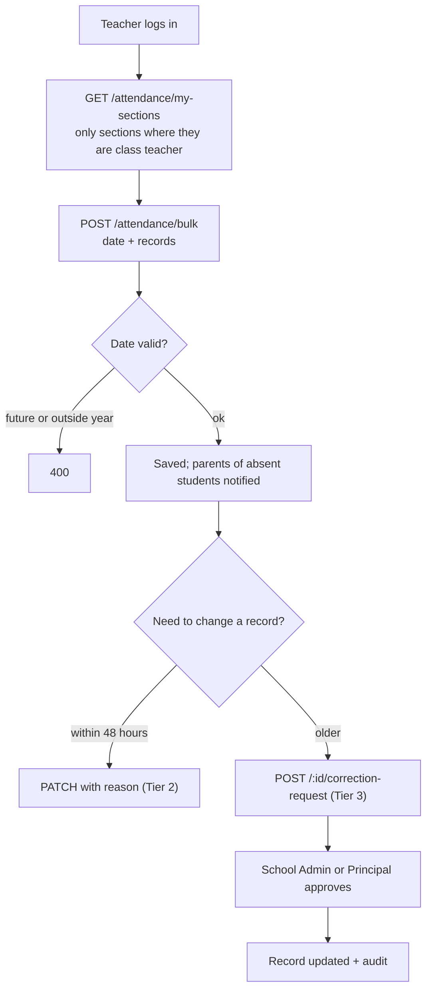
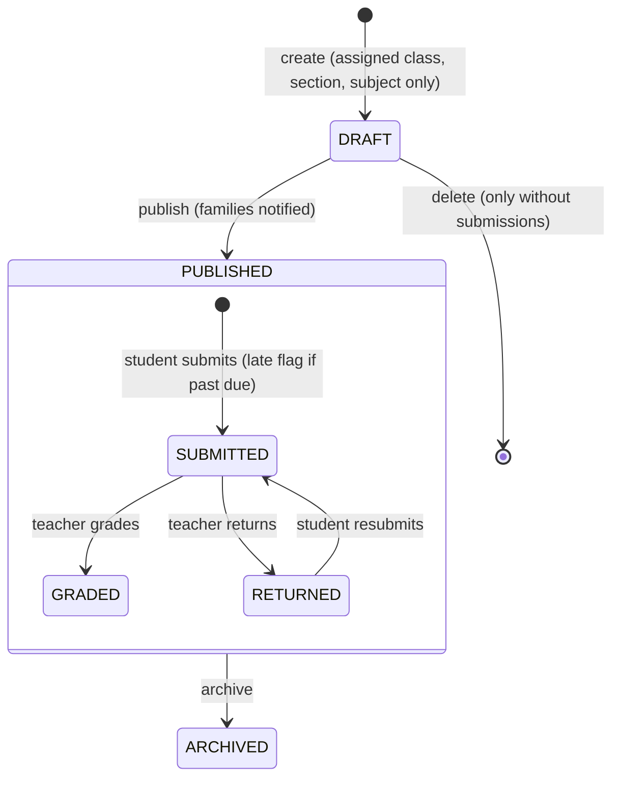
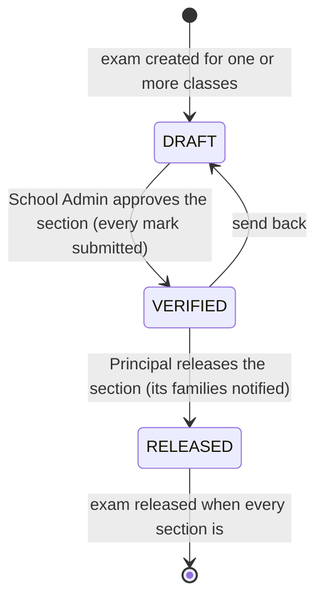
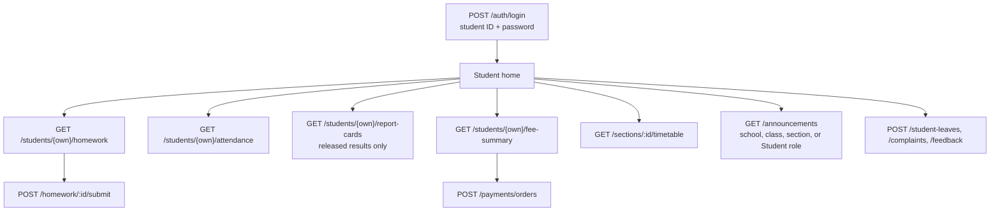
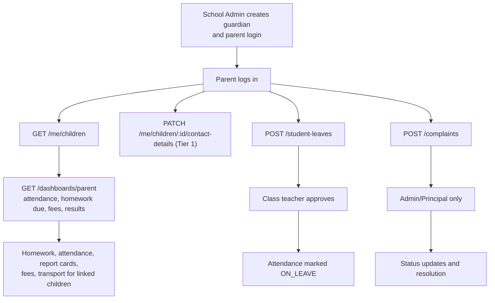
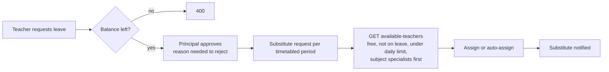

# School ERP — Role Scenarios and Permissions

What each role can do in the backend as of 2026-11-10 (`/api/v1`), based on the
seeded permissions in `backend/prisma/seed.ts` and the service code. Every
scenario marked **Works** is exercised by the end-to-end suite
(`npm run test:e2e`, 529 checks passing).

This page describes the API as built. The agreed plan, including changes not built yet
(no parent login, admission-number login for students, salary, TC, promotion), is in
[mvp-plan.md](./mvp-plan.md).

This document covers the API only. For which features have a screen, and what is
still to do for each role, see [feature-status-by-role.md](./feature-status-by-role.md).

- **Works** — implemented and covered by the e2e suite
- **Untested** — implemented but needs a real device, inbox, or account to verify
- **Partial** — works with a stated limit
- **Not built** — no implementation yet

---

## 1. How every request is checked

Access is decided at three levels: **permission**, **school**, and **record**.
Students see only themselves, parents only their linked children, teachers only
their assigned classes and sections, and School Admin, Principal, and Super Admin
the whole school.

## 2. How login works

| Scenario | Status |
|---|---|
| Login by email, admission number, or (older accounts) student or staff ID | Works |
| Generated first password must be changed before any other route works | Works |
| Lockout after repeated failures | Works |
| Logout and per-session revoke (token refused afterwards) | Works |
| Change password (current password required) | Works |
| Forgot / reset password, OTP sign-in, email verification | Untested (needs an inbox) |
| MFA setup / verify / disable | Untested (needs an authenticator app) |

## 3. Approval tiers

| Change | Tier |
|---|---|
| Parent contact details, own profile | 1 |
| Attendance edit within 48 hours (reason required) | 2 |
| Attendance older than 48 hours, marks after submission and before release, section transfer, fee structure, refund, bonafide/study certificate | 3 |
| Fee discount: only the Principal approves, never their own request | 3 |
| Student name, date of birth, admission number; marks after release; re-opening released results; transfer certificate | 4 |

A section transfer is raised by a School Admin or Principal and applies straight away.
Teachers raise only attendance and mark corrections. Every request is raised from its own
route, which sets the tier; `POST /approval-requests` refuses them, so a Tier 4 change cannot be
filed as Tier 3. Someone other than the requester must approve, except a leader's section
transfer. A fee discount or fee structure is approved only by the Principal. Super Admin fills the School Admin's slot
on Tier 4 requests, never the Principal's.

## 4. Permission matrix (seeded)

R = read, M = manage, * = limited to own / linked / assigned records. Super Admin holds
every permission since 2026-11-10; the service rules shown in its column still apply.

| Area | Super Admin | School Admin | Principal | Teacher | Accountant | Parent | Student |
|---|:-:|:-:|:-:|:-:|:-:|:-:|:-:|
| Organizations | R M | | | | | | |
| Schools and settings | R M | R M | R | | | | |
| Users, roles, overrides | R M | R M | | | | | |
| Staff and assignments | R M | R M | R | R* | | | |
| Classes, sections, subjects | R M | R M | R | R | | | |
| Academic years | R M | R M | R | | | | |
| Students | R M; register | R M; register | R | R* | R | R* | R* |
| Guardians | R M | R M | R | R* | R | R* | R* |
| Enrollments | R M | R M | R + transfer | R* | | R* | R* |
| Attendance | R M | R M | R | R; M as class teacher* | | R* | R* |
| Homework | R M | R M | R M | R M* | | R* | R* + submit |
| Announcements | R M | R M | R M | R (audience) | R | R (audience) | R (audience) |
| Examinations and marks | M, approve and release sections | M, approve sections | M, release sections | marks M*, slip tests | | released R* | released R* |
| Fees and payments | R M; discounts: request only | R M; discounts: request only | R; approves discounts | | R M | R* + pay | R* + pay |
| Student leave | decide | decide | decide | decide (class teacher) | | request | request |
| Staff leave | view | view | decide (only role) | request | request | | |
| Timetable and substitutes | R M | R M | R M | R (published) | | R (published) | R (published) |
| Complaints | R M | manage | manage | | | submit / track | submit / track |
| Certificates | R M | R M | R | | | issued R* | issued R* |
| Approvals | R M; not discounts or the Principal's slot | R M; not discounts | R M | attendance and mark corrections | request | | |
| Audit and security logs | R M | R | R | | | | |
| Reports and analytics | R M | R | R | | fee reports | | |
| Transport | R M | R M | R | | | R* | R* |
| Library | R M | R M | R | R | | R* | R* |
| Assets | R M | R M | R | | | | |
| Offline sync | R M | manage | manage | write | | | |

Extra roles: **Librarian** (library manage), **Transport Staff** (transport manage),
**Reception** (guardians and certificates manage, approval requests). Every role can
read announcements, upload files, send feedback, and manage its own notifications.
Staff, parents, and leaders also have dashboards; students do not.

---

## 5. Admin view

The account hierarchy is in the [architecture doc](../school-erp-architecture.md)
(section 2.4): only a Super Admin creates Principal, School Admin and Accountant accounts;
a School Admin creates teachers and students; a Principal creates nobody.

### 5.1 Super Admin — organization and school setup

| Scenario | Status |
|---|---|
| Create and edit own organization; schools in it; archive and restore schools | Works |
| Users, invitations, activation; roles and permission catalog | Works |
| Limited to own organization | Works |
| Archived school blocks its users | Works |
| In its own school: register teachers, subject and class teachers | Works |
| In its own school: classes, sections, per-section subjects, default subjects | Works |
| In its own school: create exams; approve and release sections (both steps) | Works |
| Every other module: academic years, students, fees, timetables, leave and more (full access) | Works |
| Creates and changes Principal, School Admin and Accountant accounts (only role that can) | Works |
| Cannot approve fee discounts, decide staff leave, or give the Principal's Tier 4 approval | Works |

### 5.2 School Admin — set up and run the year

| Scenario | Status |
|---|---|
| Academic year create, activate, summary, rollover (copy structure, optional promotion), close | Works |
| Classes get Section A automatically; sections get their own copy of the default subjects | Works |
| Per-section subjects: add, rename, remove, switch optional ones (Sanskrit) on and off | Works |
| Delete classes, sections and subjects only when nothing depends on them; a class keeps one section | Works |
| Staff with login in one call; activate/deactivate (signs them out) | Works |
| One teacher per section subject; one class teacher per section (replacing the old one) | Works |
| Removing an assignment or switching a subject off removes the teacher's access at once | Works |
| Students: register (form or Excel import with dry run; admission-number login; first password changed at first login; Aadhaar encrypted and masked), edit, assign NFC cards, archive/restore, history, documents | Works |
| Guardians with parent logins; link and unlink children | Works |
| Enrollment, promote, withdraw, section transfer | Works |
| Fee structures (submitted for the Principal), assignment to a class, cash/cheque payments, receipts, discount and refund requests | Works |
| Cannot approve discounts or decide staff leave | Works |
| Cannot create, change, deactivate or give overrides to Principal, School Admin or Accountant accounts | Works |
| Exam types FA1-FA4, Q1-Q3, Pre-public (Class 10 only), Other; one exam for several classes | Works |
| Approve each section's marks when complete, or every ready section at once; send back | Works |
| Approve and release slip tests | Works |
| Reopen a released exam via Tier 4 | Works |
| Timetable generation with conflict checks; substitutes | Works |
| Complaints: assign, investigate, resolve; SLA auto-escalation | Works |
| Certificates: approve, generate, download | Works |
| Permission overrides per user | Works |
| Audit log search, CSV export, entity history; security events | Works |
| Dashboards, reports, analytics | Works |
| Transport, library, assets | Works |

### 5.3 Principal — oversight and approvals

| Scenario | Status |
|---|---|
| Read students, guardians, structure, attendance, staff | Works |
| Homework and announcements management | Works |
| Release approved exam sections, one at a time or all at once; cannot give the first approval | Works |
| Principal approval on Tier 4 requests, including rejection | Works |
| Principal dashboard, reports, analytics, audit | Works |
| Decide staff leave: the only role that can; a rejection needs a reason | Works |
| Approve fee discounts: the only role that can, never its own request | Works |
| Manage timetable and substitutes | Works |
| Create accounts | Not planned: Super Admin creates senior accounts |

### 5.4 Accountant

| Scenario | Status |
|---|---|
| Fee structures (submit for approval), assign, record and verify payments, receipts | Works (as School Admin in tests) |
| Request discounts (the Principal approves) and refunds | Works (as School Admin in tests) |
| Overdue list, fee reports, accountant dashboard | Works (as School Admin in tests) |
| No access to marks, attendance, complaints | Untested (no Accountant login in the tests) |

---

## 6. Teacher view

### 6.1 Daily attendance

### 6.2 Homework

### 6.3 Marks

Each section of an exam moves through these states on its own, so a finished section does
not wait for the others.

Slip tests skip the Principal: the School Admin's approval releases them. Marks in an
approved section are locked; changes go through a correction request (Tier 3 before
release, Tier 4 after).

| Scenario | Status |
|---|---|
| Daily attendance only as class teacher of the section; 48-hour rule; bulk; corrections | Works |
| Subject teachers can view their sections' attendance but not change it | Works |
| Attendance by NFC card ID; repeat taps, unknown cards, and other sections handled | Works (typed IDs; no real card tried) |
| Card IDs match in any case; saved and scanned in uppercase | Works (students and attendance scans) |
| Homework for assigned class + section + subject; grade and return | Works |
| Marks entry and bulk entry for own subject and sections; submit; Tier 3/4 corrections | Works |
| Exam subjects listed as waiting, approved, or released; mark sheet per subject | Works |
| Slip tests for own section and subject | Works |
| Cannot change classes, sections, subjects or teacher assignments | Works |
| Register students; view (not edit) details of own students | Works |
| Cannot edit student details or request a name, date of birth, or section change | Works |
| Decide leave for own class (class teacher) | Works |
| Own timetable, substitute duties, pending work dashboard | Works |
| Request own leave; balance checked against entitlements | Works |
| Offline attendance and mark drafts via sync, with conflicts | Works |

---

## 7. Student view

| Scenario | Status |
|---|---|
| See only own record, attendance, homework, marks, fees | Works |
| Submit homework; graded work cannot be overwritten | Works |
| Marks and report card as soon as the student's own section is released | Works |
| Pay online (order + verified webhook) | Works (dev order ids; real Razorpay needs keys) |
| Request leave; file anonymous or named complaints | Works |
| Library history, transport details, issued certificates | Works |
| Student dashboard | Not built |

## 8. Parent view

**Plan:** the parent login is removed from the apps in MVP1 and the family uses the student's
login (see [mvp-plan.md](./mvp-plan.md)). The API below still works and stays, hidden.

| Scenario | Status |
|---|---|
| Parent login linked to children | Works |
| Sees only linked children and their guardians | Works |
| Child's marks and report card once the child's section is released | Works |
| Notifications: absence, homework, results, payments, boarding | Works (in-app); push and SMS senders built, not verified with real services |
| Complaints never shown to the named teacher; submitter hidden from staff | Works |

---

## 9. Leave and substitutes

## 10. Remaining gaps

| Gap | Effect |
|---|---|
| Push, SMS, and email not verified | Senders are written, but only the console sender has been tested |
| Real NFC cards not tested | Scanning is covered with typed card IDs only |
| No Accountant login in the tests | Accountant limits are set by permissions but not covered end to end |
| Reports run synchronously | Very large exports may be slow |
| Super Admin gives both exam approvals | It can approve and release results on its own |
| Older school-wide subjects | Not shown on the new screens; assignments using them still work and cover same-code section subjects in exams |
| Sections without students | Count as complete, so they still need approving and releasing before an exam shows as fully released |
