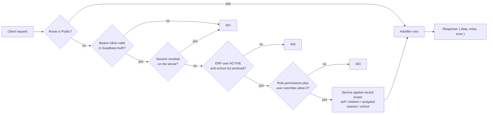
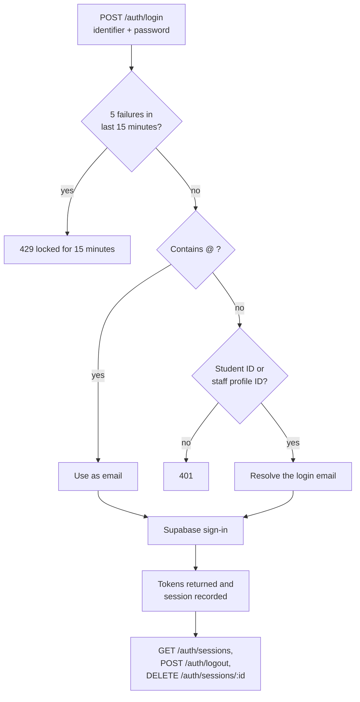
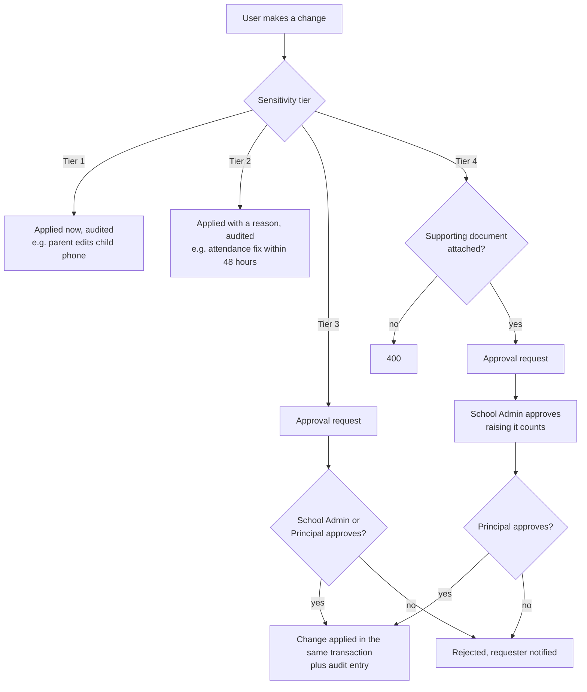
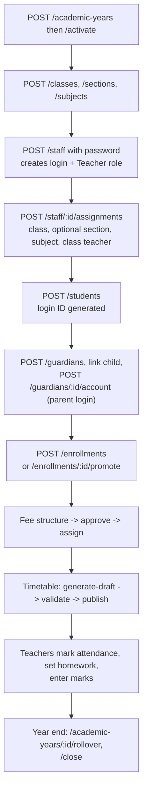
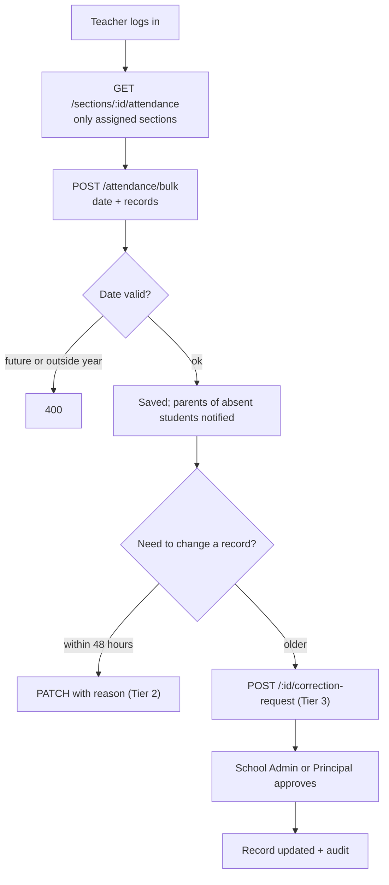
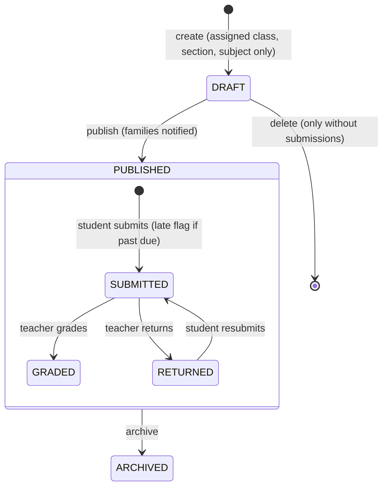
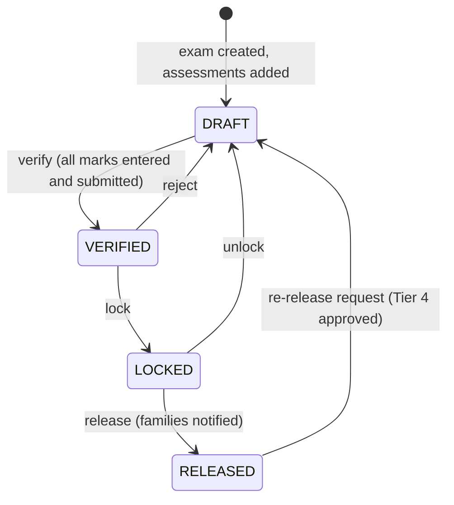
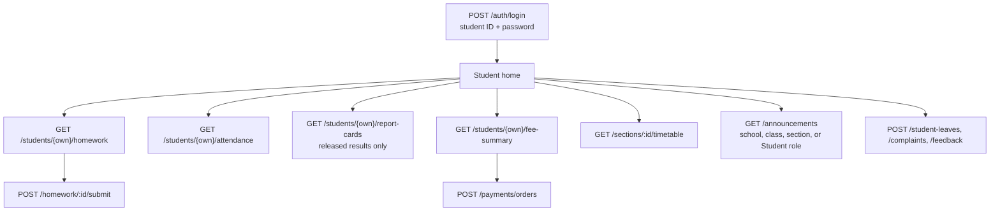
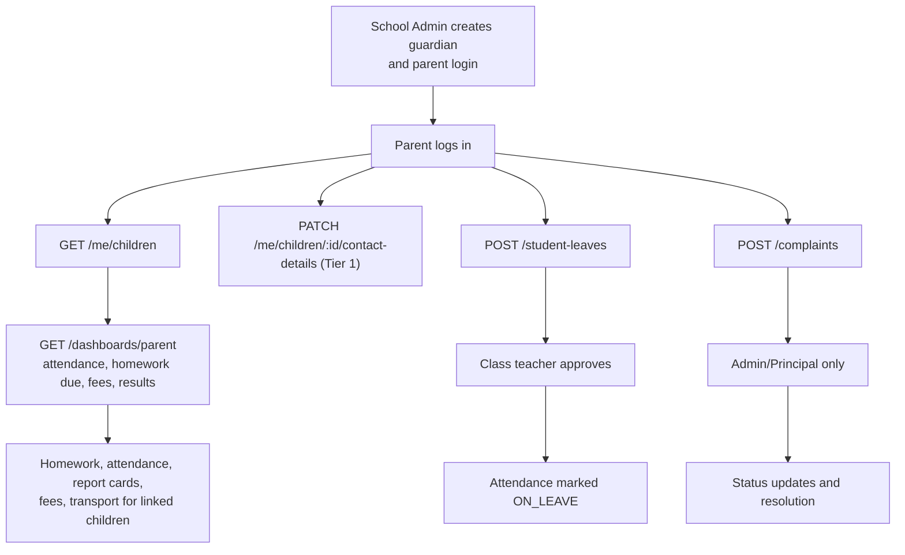
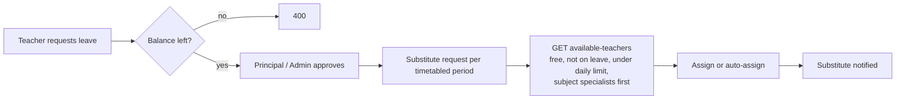

# School ERP — Role Scenarios and Permissions

What each role can do in the backend as of 2026-11-05 (`/api/v1`), based on the
seeded permissions in `backend/prisma/seed.ts` and the service code. Every
scenario marked **Works** is exercised by the end-to-end suite
(`npm run test:e2e`, 343 checks passing).

This document covers the API only. For which features have a screen, and what is
still to do for each role, see [feature-status-by-role.md](./feature-status-by-role.md).

- **Works** — implemented and covered by the e2e suite
- **Untested** — implemented but needs a real device, inbox, or account to verify
- **Partial** — works with a stated limit
- **Not built** — no implementation yet

---

## 1. How every request is checked

Access is decided at three levels: **permission**, **school**, and **record**.
Students see only themselves, parents only their linked children, teachers only
their assigned classes and sections, and School Admin, Principal, and Super Admin
the whole school.

## 2. How login works

| Scenario | Status |
|---|---|
| Login by email, student ID, or staff ID | Works |
| Lockout after repeated failures | Works |
| Logout and per-session revoke (token refused afterwards) | Works |
| Change password (current password required) | Works |
| Forgot / reset password, OTP sign-in, email verification | Untested (needs an inbox) |
| MFA setup / verify / disable | Untested (needs an authenticator app) |

## 3. Approval tiers

| Change | Tier |
|---|---|
| Parent contact details, own profile | 1 |
| Attendance edit within 48 hours (reason required) | 2 |
| Attendance older than 48 hours, marks after submission and before release, section transfer, fee structure, discount, refund, bonafide/study certificate | 3 |
| Student name, date of birth, admission number; marks after release; re-opening released results; transfer certificate | 4 |

A section transfer is raised by a School Admin or Principal and applies straight away.
Teachers raise only attendance and mark corrections.

## 4. Permission matrix (seeded)

R = read, M = manage, * = limited to own / linked / assigned records.

| Area | Super Admin | School Admin | Principal | Teacher | Accountant | Parent | Student |
|---|:-:|:-:|:-:|:-:|:-:|:-:|:-:|
| Organizations | R M | | | | | | |
| Schools and settings | R M | R M | R | | | | |
| Users, roles, overrides | R M | R M | | | | | |
| Staff and assignments | | R M | R | R* | | | |
| Classes, sections, subjects, years | | R M | R | R | | | |
| Students | | R M | R | R + register* | R | R* | R* |
| Guardians | | R M | R | R* | R | R* | R* |
| Enrollments | | R M | R + transfer | R* | | R* | R* |
| Attendance | | R M | R | R M* | | R* | R* |
| Homework | R M | R M | R M | R M* | | R* | R* + submit |
| Announcements | R M | R M | R M | R (audience) | R | R (audience) | R (audience) |
| Examinations and marks | | M, verify, release | M, verify, release | marks M* | | released R* | released R* |
| Fees and payments | | R M | R | | R M | R* + pay | R* + pay |
| Student leave | | decide | decide | decide (class teacher) | | request | request |
| Staff leave | | decide | decide | request | request | | |
| Timetable and substitutes | | R M | R M | R (published) | | R (published) | R (published) |
| Complaints | | manage | manage | | | submit / track | submit / track |
| Certificates | | R M | R | | | issued R* | issued R* |
| Approvals | R M | R M | R M | attendance and mark corrections | request | | |
| Audit and security logs | R | R | R | | | | |
| Reports and analytics | R | R | R | | fee reports | | |
| Transport | | R M | R | | | R* | R* |
| Library | | R M | R | R | | R* | R* |
| Assets | | R M | R | | | | |
| Offline sync | | manage | manage | write | | | |

Extra roles: **Librarian** (library manage), **Transport Staff** (transport manage),
**Reception** (guardians and certificates manage, approval requests). Every role can
read announcements, upload files, send feedback, and manage its own notifications.
Staff, parents, and leaders also have dashboards; students do not.

---

## 5. Admin view

The intended account hierarchy is in the
[architecture doc](../school-erp-architecture.md) (section 2.4). Today a School Admin
creates accounts, and a Principal cannot.

### 5.1 Super Admin — organization

| Scenario | Status |
|---|---|
| Create and edit own organization; schools in it; archive and restore schools | Works |
| Users, invitations, activation; roles and permission catalog | Works |
| Limited to own organization | Works |
| Archived school blocks its users | Works |

### 5.2 School Admin — set up and run the year

| Scenario | Status |
|---|---|
| Academic year create, activate, summary, rollover (copy structure, optional promotion), close | Works |
| Classes, sections (archive when empty), subjects | Works |
| Staff with login in one call; activate/deactivate (signs them out) | Works |
| Section-level teacher assignments, class teacher flag, reassignment | Works |
| Students: register, edit, assign NFC cards, archive/restore, history, documents | Works |
| Guardians with parent logins; link and unlink children | Works |
| Enrollment, promote, withdraw, section transfer | Works |
| Fee structures, assignment to a class, cash/cheque payments, receipts, discounts, refunds | Works |
| Examinations: verify, lock, release; reopen via Tier 4 | Works |
| Timetable generation with conflict checks; substitutes | Works |
| Complaints: assign, investigate, resolve; SLA auto-escalation | Works |
| Certificates: approve, generate, download | Works |
| Permission overrides per user | Works |
| Audit log search, CSV export, entity history; security events | Works |
| Dashboards, reports, analytics | Works |
| Transport, library, assets | Works |

### 5.3 Principal — oversight and approvals

| Scenario | Status |
|---|---|
| Read students, guardians, structure, attendance, staff | Works |
| Homework and announcements management | Works |
| Verify and release results | Works (as School Admin in tests) |
| Principal approval on Tier 4 requests, including rejection | Works |
| Principal dashboard, reports, analytics, audit | Works |
| Decide staff leave; manage timetable and substitutes | Works |
| Create a School Admin | Not built |

### 5.4 Accountant

| Scenario | Status |
|---|---|
| Fee structures (submit for approval), assign, record and verify payments, receipts | Works (as School Admin in tests) |
| Request discounts and refunds (Tier 3) | Works (as School Admin in tests) |
| Overdue list, fee reports, accountant dashboard | Works (as School Admin in tests) |
| No access to marks, attendance, complaints | Untested (no Accountant login in the tests) |

---

## 6. Teacher view

### 6.1 Daily attendance

### 6.2 Homework

### 6.3 Marks

| Scenario | Status |
|---|---|
| Attendance only for assigned classes/sections; 48-hour rule; bulk; corrections | Works |
| Attendance by NFC card ID; repeat taps, unknown cards, and other sections handled | Works (typed IDs; no real card tried) |
| Card IDs match in any case; saved and scanned in uppercase | Works (students and attendance scans) |
| Homework for assigned class + section + subject; grade and return | Works |
| Marks entry and bulk entry for own students; submit; Tier 3/4 corrections | Works |
| Register students; view (not edit) details of own students | Works |
| Cannot edit student details or request a name, date of birth, or section change | Works |
| Decide leave for own class (class teacher) | Works |
| Own timetable, substitute duties, pending work dashboard | Works |
| Request own leave; balance checked against entitlements | Works |
| Offline attendance and mark drafts via sync, with conflicts | Works |

---

## 7. Student view

| Scenario | Status |
|---|---|
| See only own record, attendance, homework, marks, fees | Works |
| Submit homework; graded work cannot be overwritten | Works |
| Report card with grades after release | Works |
| Pay online (order + verified webhook) | Works (dev order ids; real Razorpay needs keys) |
| Request leave; file anonymous or named complaints | Works |
| Library history, transport details, issued certificates | Works |
| Student dashboard | Not built |

## 8. Parent view

| Scenario | Status |
|---|---|
| Parent login linked to children | Works |
| Sees only linked children and their guardians | Works |
| Notifications: absence, homework, results, payments, boarding | Works (in-app); push and SMS senders built, not verified with real services |
| Complaints never shown to the named teacher; submitter hidden from staff | Works |

---

## 9. Leave and substitutes

## 10. Remaining gaps

| Gap | Effect |
|---|---|
| Approval tier is set by the caller | A School Admin or Principal can file a Tier 4 change as Tier 3 through `POST /approval-requests` and approve it alone |
| Account hierarchy not built | A Principal cannot create a School Admin, and a School Admin can assign the Principal role |
| Card ID required at registration | A student cannot be registered first and given a card later |
| Push, SMS, and email not verified | Senders are written, but only the console sender has been tested |
| Real NFC cards not tested | Scanning is covered with typed card IDs only |
| No Accountant login in the tests | Accountant limits are set by permissions but not covered end to end |
| Reports run synchronously | Very large exports may be slow |
